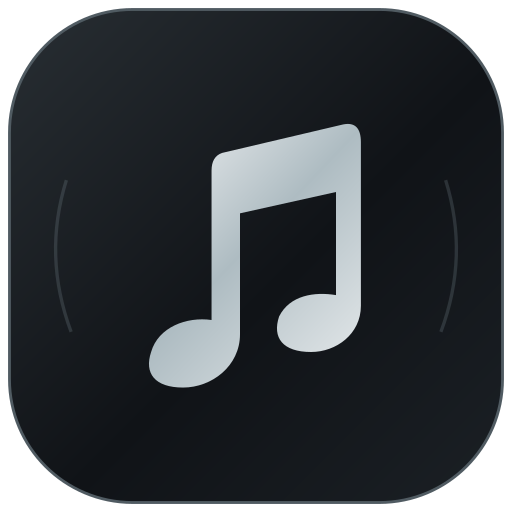
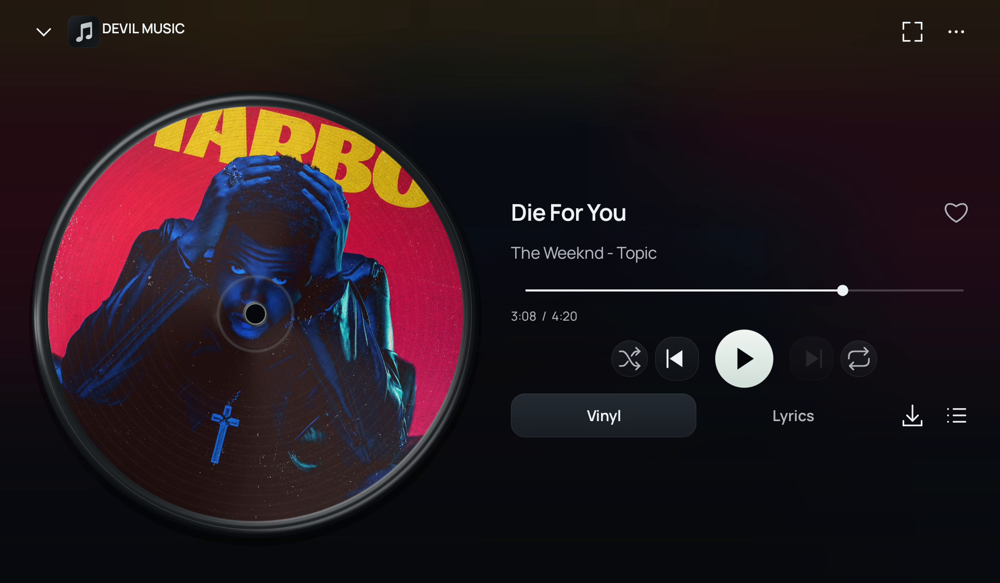
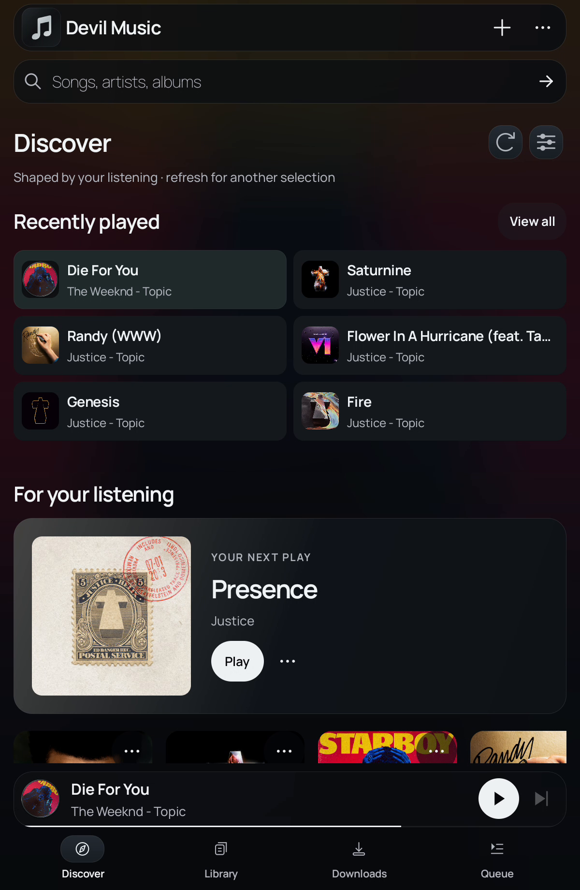
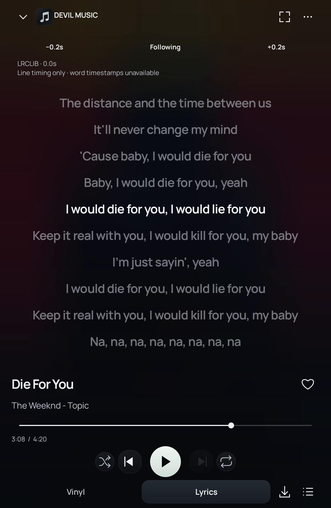
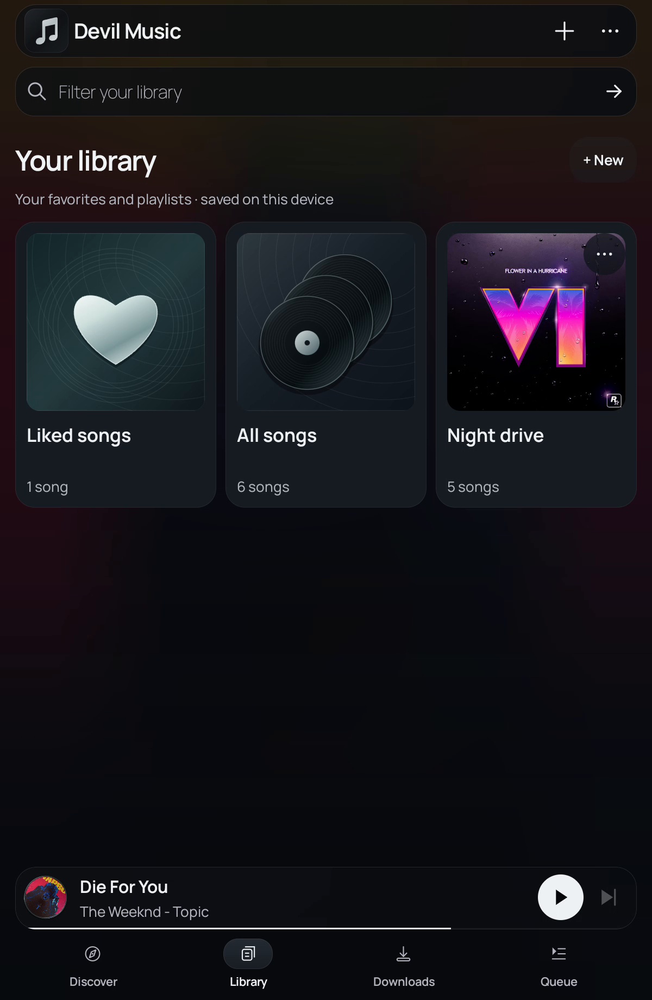
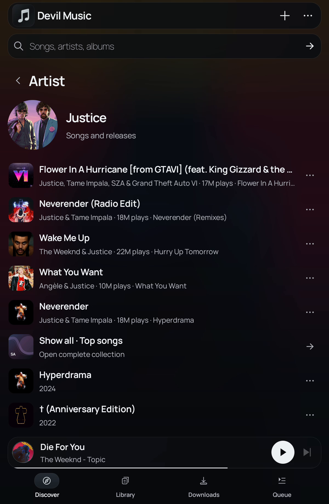

# Devil Music

**A listening room that feels like your music.**

Native Android playback · Cover-shaped atmosphere · A record you can turn

[Download](https://github.com/Pronexsteam/DevilMusic/releases/tag/v0.0.18) · [Features](#made-for-listening) · [Build](BUILDING.md) · [Report a problem](https://github.com/Pronexsteam/DevilMusic/issues) · [Desktop Deviload](https://github.com/Pronexsteam/deviload)

Devil Music is an independent Android music player growing out of [Deviload](https://github.com/Pronexsteam/deviload). Browse the public YouTube Music catalog, listen to your own files, and shape your library without a Devil Music account. This repository currently contains the **Android preview**. Desktop Devil Music remains inside Deviload for now; this is not a standalone desktop release.

## Made for listening

- **Find your next song.** Search tracks, artists, albums and playlists, with suggestions and artwork. Home blends familiar tracks with more music from artists you enjoy. It learns from local listening history and explicit feedback, without filling shelves from regional charts. A fresh profile starts with your own search.
- **Follow an artist.** Open an artist page from a song or the player, browse songs and releases, and return to your collection. If a name matches several artists, choose the right one instead of opening a guessed profile.
- **A player with a physical feel.** Turn the picture disc with your finger. The cover stays live under a Blender-rendered lacquer, pressed centre and rounded edge. Ambient colour comes from the artwork; music drives subtle material accents.
- **Lyrics with room to breathe.** Switch between Vinyl and Lyrics without losing playback, or enter an immersive cover-background view with hideable controls. Timed words receive a soft glow when the source supplies word timestamps; line-synced and plain lyrics remain supported. Missing timestamps are never presented as real word sync.
- **A library with a place for everything.** Liked songs, all songs and your playlists have their own cover tiles. Save a favorite with the player's heart. Create, rename and edit playlists, add songs from their action menu, or save the current queue. Play a whole collection or browse its tracks. Removing a playlist keeps audio files and listening history intact.
- **Your queue, in your order.** Drag to reorder, play next, undo removals, shuffle and repeat. Rounded transport controls distinguish shuffle, repeat-all and repeat-one at a glance. Shuffle keeps a stable permutation through queue edits and restart; selecting a song or using Play next can intentionally revisit it.
- **A home you can arrange.** Reorder and hide shelves with drag handles. Recent listens and saved albums or mixes stay close at hand.
- **Phone and tablet layouts.** A compact player opens into a larger listening view. Rotation keeps the current player, lyrics selection and playback position; landscape has space for the record and words together.
- **Keep listening.** Media3 owns background audio. Optional next-track preloading prepares a short audio segment. Save supported tracks offline, open local audio, set a sleep timer, or adjust playback speed.
- **Artwork that stays close.** A bounded memory cache and a 64 MiB disposable disk cache reuse viewed covers across screens and restarts. Image updates wait during fast list flings; full-player artwork keeps its higher-resolution target.
- **Stay current.** The app checks published GitHub releases once a day while open. A new-version banner opens release notes and an APK download; Android asks you to confirm installation. You can also use Playback options → Check for updates.
- **Bring a collection.** Exchange library metadata with desktop Devil Music using a file. It does not copy account credentials or audio files, and it is not automatic account sync.

<table><tr>
<td width="50%"></td>
<td width="50%"></td>
</tr><tr>
<td width="50%"></td>
<td width="50%"></td>
</tr></table>

## Install the preview

1. Open the [Android release](https://github.com/Pronexsteam/DevilMusic/releases/tag/v0.0.18) and download `Devil-Music-0.0.18-android.apk`.
2. Open it on Android **8.0 or newer** and allow installation from the app you used to open it.
3. Future versions are offered inside this build. Older builds without the update checker need this APK installed once manually.
4. If you already use the normal preview, install over it to retain app data. **Do not uninstall first.** The package-isolated QA copy has its own library and is not migrated into the normal app.

The APK is a signed, non-debuggable preview, not a Play Store release. Keep a library export before testing preview software. The release includes its checksum and corresponding source; [build instructions](BUILDING.md) explain local builds and signing.

## What is still evolving?

This is an early preview, not feature parity with desktop Devil Music. Automatic PC/phone sync, complete catalog pagination and broader recommendation models are still work ahead. The interface is currently English. Word timing and artwork quality depend on the source; not every song has either. Online playback depends on YouTube, region and network availability. Requests rejected by upstream protection stop rather than being silently bypassed.

Recommendation signals stay on the device. Catalog, stream and artwork requests contact their providers; lyrics retrieval contacts its configured provider. The app does not upload your listening profile to a Devil Music server. See [privacy](PRIVACY.md) and the [validation notes](docs/validation/preview-0.0.18.md) for tested behaviour and limits.

## Built in the open

Kotlin · native Android Views/Canvas · Media3 · NewPipe Extractor. No WebView is needed to draw the player. Runtime vinyl uses one shared texture, not a running Blender scene.

The Android application is **GPL-3.0-or-later**. [License](LICENSE) · [Dependency notices](app/src/main/assets/licenses/NOTICE.txt). Manrope is distributed under the SIL Open Font License. Cover artwork belongs to its respective owners and is shown in screenshots of real playback, not shipped as bundled catalog content.

If you like the direction, a [star](https://github.com/Pronexsteam/DevilMusic) helps others find the project. Please include your Android version, device and reproduction steps when [reporting a problem](https://github.com/Pronexsteam/DevilMusic/issues/new).
